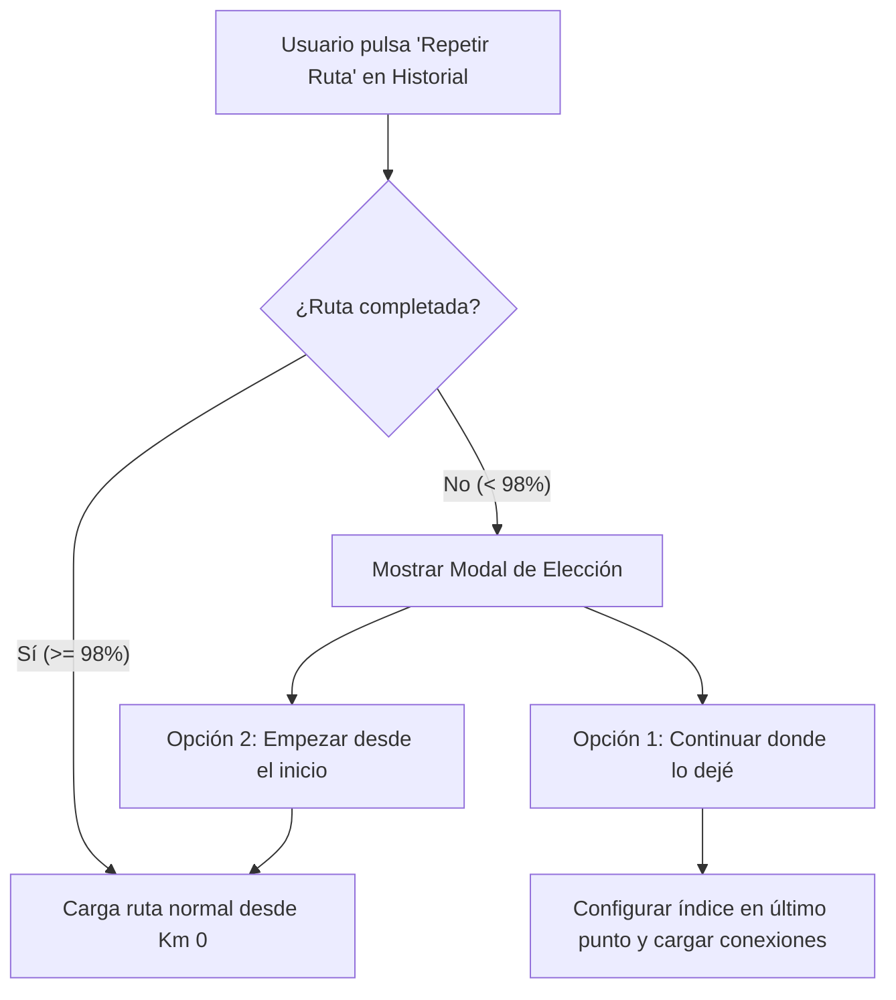

# Plan de Implementación: Reanudación de Rutas Incompletas y Selección de Tramos

Este documento describe la arquitectura, diseño funcional y hoja de ruta técnica para incorporar dos funcionalidades clave en **RodilloInt**:
1. **Reanudación o Reinicio de Rutas desde el Historial** (cuando una sesión no se completó).
2. **Selector de Tramo Personalizado (Inicio y Fin)** al iniciar cualquier ruta (desde el catálogo, guardadas o archivo GPX).

---

## 1. Visión General y Objetivos

### 🎯 Objetivo 1: Reanudar rutas desde el Historial
Permitir que el usuario, tras haber interrumpido una ruta (por tiempo, fatiga o avería), pueda continuarla exactamente en el kilómetro donde se quedó o elegir reiniciarla desde el principio.

### 🎯 Objetivo 2: Selector de tramos (Segment Trimmer)
Permitir que el ciclista recorte cualquier ruta para entrenar únicamente la sección que le interesa (por ejemplo, subir un puerto sin tener que hacer los 30 km llanos previos de aproximación).

---

## 2. Arquitectura de Datos y Lógica Matemática

### 2.1. Detección de Ruta Incompleta
En la base de datos IndexedDB (`sessions`), cada sesión almacena:
- `session.totalDistance`: Kilómetros recorridos por el ciclista en la sesión.
- `session.routeDistances`: Array de distancias acumuladas de la ruta original.
- Longitud total de la ruta: `totalRouteKm = routeDistances[routeDistances.length - 1]`.

**Criterio de Incompleto:**
Una ruta se considera incompleta si:
$$\text{session.totalDistance} < (\text{totalRouteKm} - 0.4)$$
*(Con un margen de cortesía de ~400 metros para tolerar desvíos o paradas justo en meta).*

### 2.2. Normalización de Tramos Recortados
Cuando se selecciona un tramo comprendido entre el índice inicial $i_{\text{start}}$ y el índice final $i_{\text{end}}$:
1. **Puntos GPS:**
   $$\text{routePoints}' = \text{routePoints}[i_{\text{start}} \dots i_{\text{end}}]$$
2. **Elevaciones:**
   $$\text{routeElevations}' = \text{routeElevations}[i_{\text{start}} \dots i_{\text{end}}]$$
3. **Distancias Normalizadas (comenzando en 0):**
   Para cada punto $k$ del nuevo tramo:
   $$\text{routeDistances}'[k] = \text{routeDistances}[i_{\text{start}} + k] - \text{routeDistances}[i_{\text{start}}]$$
4. **Desnivel Acumulado:**
   Se recalcula usando la función existente `calculateTotalRouteAscent(routeElevations')`.

---

## 3. Experiencia de Usuario (UI/UX)

### 3.1. Flujo desde el Historial ("Repetir Ruta")

**Diseño del Diálogo Emergente:**
- **Título:** Ruta Inconclusa detectada
- **Mensaje:** *"En tu sesión anterior recorriste 18.5 km de los 45.0 km totales (41% completado)."*
- **Botón Primario:** ⏩ *Continuar desde el Km 18.5*
- **Botón Secundario:** 🔄 *Empezar desde el inicio (Km 0)*
- **Botón Cancelar:** ✖️ *Cancelar*

### 3.2. Flujo del Selector de Tramo (Modal de Configuración de Ruta)
Dentro del modal existente `#route-modal` (donde se configura el deslizador de realismo):
1. **Controles de Rango:**
   - Deslizador doble (*Dual-range slider*) o dos entradas numéricas:
     - `Km Inicio` (mínimo: 0, valor por defecto: 0).
     - `Km Fin` (máximo: longitud total, valor por defecto: longitud total).
2. **Interacción con el Perfil Altimétrico (SVG):**
   - El gráfico de elevación sombrea en color translúcido la zona seleccionada.
   - Posibilidad de hacer clic sobre el gráfico para definir inicio y fin.
3. **Panel de Métricas Dinámicas:**
   - Al mover el selector, se actualizan inmediatamente:
     - *Distancia seleccionada:* `18.2 km` (de 62.0 km totales).
     - *Desnivel del tramo:* `+650 m`.
     - *Pendiente media:* `4.2%`.

---

## 4. Módulos y Archivos Afectados

| Módulo / Archivo | Responsabilidad / Cambio |
| :--- | :--- |
| `js/core/routeLibrary.js` | Función pura `sliceRoute(routeData, startKm, endKm)` para extraer y normalizar sub-tramos. |
| `js/core/history.js` | En `repeatRouteFromHistory(id)`: verificar si la sesión fue incompleta y mostrar modal de confirmación antes de iniciar. |
| `js/ui/modals.js` | Apertura del diálogo de decisión y gestión del estado del selector de tramos en el modal de ruta. |
| `js/ui/routeOverviewSvg.js` | Renderizado del tramo recortado y soporte para colorear el tramo ya recorrido al continuar. |
| `index.html` | Marcado HTML para los controles de tramo en `#route-modal` y modal de reanudación de historial. |
| `styles/workout.css` | Estilos para el selector de rango doble y la zona seleccionada en el perfil SVG. |

---

## 5. Casos Límite y Consideraciones Técnicas

1. **Arranque Suave de Resistencia (*Soft Start*):**
   - Si se reanuda la ruta en una rampa con pendiente dura (ej. 10%), el rodillo no debe clavar la resistencia en seco en el segundo 0.
   - **Solución:** Implementar una rampa de aproximación de 5 segundos donde la resistencia sube gradualmente desde 0% hasta la pendiente real del punto.
2. **Integridad de Exportaciones (FIT / CSV / GPX):**
   - La nueva sesión iniciada registra únicamente la telemetría pedaleada en ese día (empezando en tiempo 0 y distancia 0 para esa sesión).
   - En el archivo GPX/FIT generado, las coordenadas GPS corresponden al tramo pedaleado, garantizando compatibilidad total con Strava y Garmin Connect.
3. **Soporte de Cámara y Mapa:**
   - Tanto Leaflet como MapLibre deben centrar la vista y el marcador del ciclista en las coordenadas del nuevo punto de partida inmediatamente tras iniciar.

---

## 6. Fases de Ejecución Recomendadas

- [x] **Fase 1 (Lógica pura):** Crear helper `sliceRouteSegment(options)` con interpolación precisa en `js/core/routeLibrary.js`.
- [x] **Fase 2 (Historial):** Integrar modal "Continuar vs. Reiniciar" (`#modal-resume-route`) en `js/core/history.js` y `js/ui/historyView.js`.
- [x] **Fase 3 (Selector en Ruta):** Añadir controles interactivos de inicio/fin y gráfico SVG con tiradores arrastrables en `#route-modal`.
- [x] **Fase 4 (Kilometraje Real en el HUD):** Indicador de punto kilométrico real en ruta (`Km X.X / Y.Y`) en el panel de progreso y bajo el velocímetro en el HUD para tramos recortados o continuados.
- [x] **Fase 5 (Calentamiento Plano - Flat Warmup):** Casilla opcional de 5 minutos al 0% en modales de ruta e historial, banner con cuenta atrás en HUD y botón para saltar al puerto en cualquier momento.

